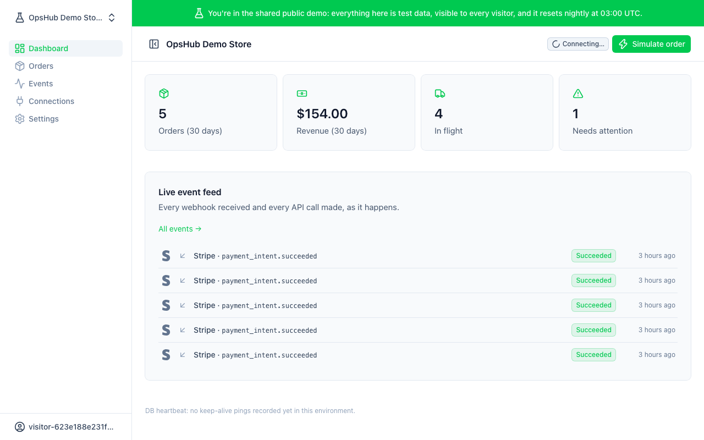
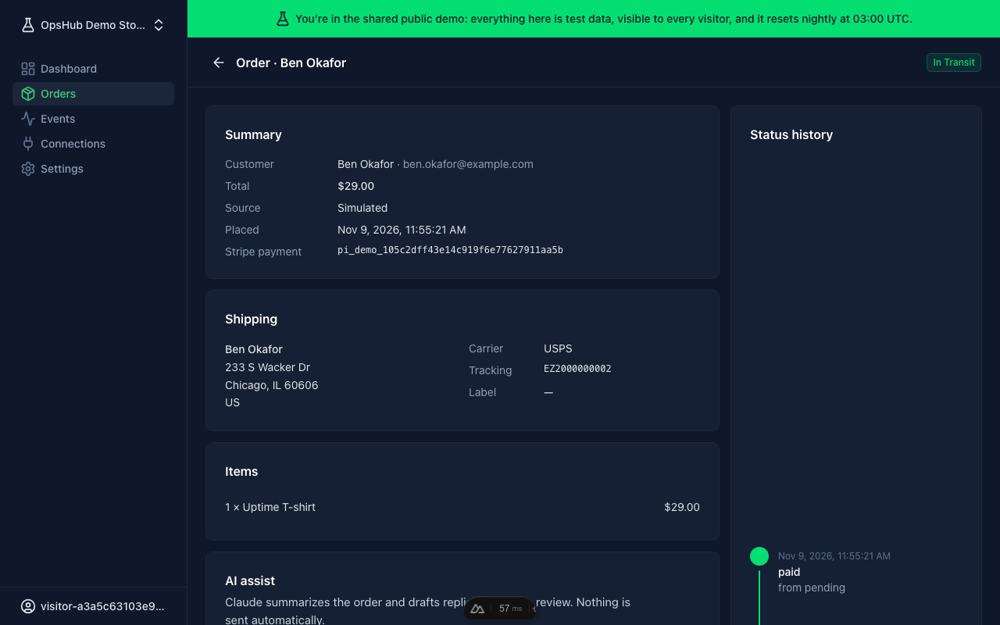
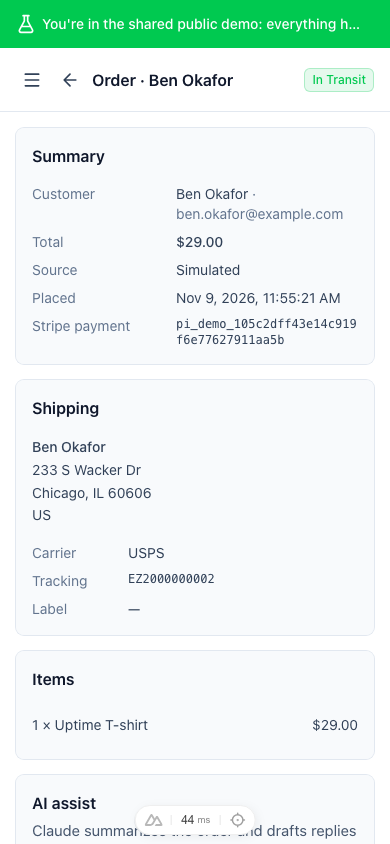
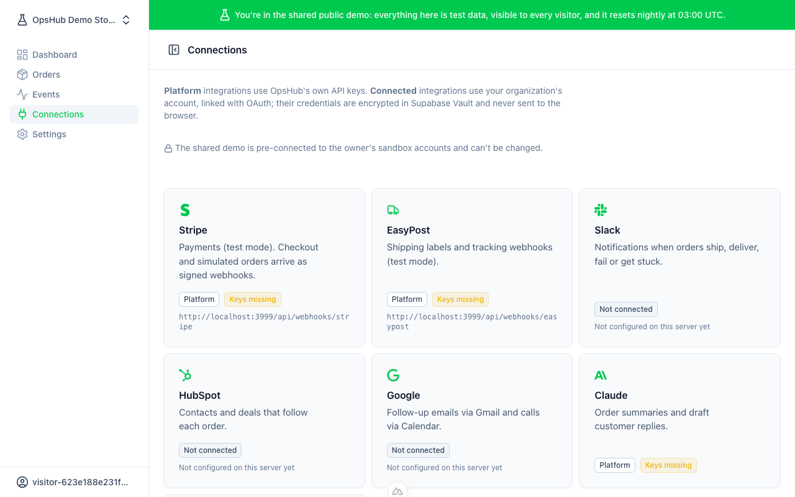

# OpsHub

**An order-operations dashboard that shows how to build third-party integrations that don't fall over.**

A single order flows through seven real services. A Stripe payment becomes an order. EasyPost buys a label and tracks the parcel. HubSpot gets a contact and deal. Slack or Discord hears when it ships, gets stuck or fails. Gmail sends a follow-up and Calendar books a call. Claude summarizes it all for the support team. Every inbound and outbound call is verified, logged, idempotent and retryable from the UI.



> **Status:** feature-complete and tested locally; going live once the cloud accounts are set up ([launch checklist](docs/launch-checklist.md)). Progress: [build plan](docs/plan/README.md).

## What it demonstrates

| | |
|---|---|
| **Webhooks you can trust** | Signatures verified on the raw body (Stripe, EasyPost); the event is stored *before* anything happens; replays are no-ops |
| **Exactly-once where the API allows it, honest where it doesn't** | Idempotency keys, unique ids enforced by the database, upserts on unique CRM properties; at-least-once documented where an API offers no other option (Gmail) |
| **Retries that behave** | Exponential backoff with jitter, `Retry-After` honored, dead-lettering, a **Retry** button in the UI |
| **A webhook inspector** | Every call with redacted payloads, attempts, timings and errors |
| **OAuth done properly** | Single-use state bound to the browser, PKCE, token refresh with compare-and-set, credentials only in Supabase Vault |
| **Multi-tenant security** | Postgres RLS; the browser is read-only; org-scoped composite foreign keys make cross-tenant links impossible |
| **A public demo that's safe to share** | One throwaway account per visitor, nightly reset that provably can't touch real orgs, rate limits and AI token budgets |

## How an order moves through the system

```mermaid
sequenceDiagram
    autonumber
    participant S as Stripe
    participant O as OpsHub
    participant DB as Postgres (events = log + queue)
    participant E as EasyPost
    participant X as HubSpot / Slack / Discord / Gmail
    S->>O: payment_intent.succeeded (signed)
    O->>O: verify signature on raw body
    O->>DB: store event (unique provider + event id)
    O-->>S: 200 OK
    DB->>O: worker claims event (FOR UPDATE SKIP LOCKED)
    O->>DB: create order (unique payment id) + status history
    O->>DB: enqueue follow-ups with deterministic keys
    O->>E: buy label, start tracking
    E->>O: tracker.updated (HMAC-signed)
    O->>DB: in_transit → delivered (never backwards)
    O->>X: notify / sync deal / follow-up email
    Note over O,DB: failures retry with backoff + Retry-After; then dead-letter and a Retry button
```

Each step is a row in one `events` table that is both the **audit log** and the **job queue** ([ADR 0004](docs/decisions/0004-events-table-is-log-and-queue.md)), so what the inspector shows is exactly what the worker does.

## Where to look in the code

| Concern | Code |
|---|---|
| The integration contract | [`server/integrations/types.ts`](server/integrations/types.ts) |
| One generic webhook endpoint | [`server/api/webhooks/[provider].post.ts`](server/api/webhooks/%5Bprovider%5D.post.ts) |
| Retry engine (framework-free, unit-tested) | [`server/lib/worker.ts`](server/lib/worker.ts), [`backoff.ts`](server/lib/backoff.ts), [`http.ts`](server/lib/http.ts), [`redact.ts`](server/lib/redact.ts) |
| Stripe signature verification, from the spec | [`server/integrations/stripe/signature.ts`](server/integrations/stripe/signature.ts) |
| Status mapping that never goes backwards | [`server/integrations/easypost/status.ts`](server/integrations/easypost/status.ts) |
| OAuth state + PKCE | [`server/lib/oauth.ts`](server/lib/oauth.ts), [`server/api/oauth/`](server/api/oauth) |
| Token refresh with compare-and-set | [`server/lib/connections.ts`](server/lib/connections.ts) |
| Cross-provider choreography | [`server/flows/order-flow.ts`](server/flows/order-flow.ts) |
| Schema, RLS, queue, demo reset | [`supabase/migrations/`](supabase/migrations) + [`supabase/tests/`](supabase/tests) (pgTAP) |

## Adding an integration

Every provider implements one interface. Discord was added last, specifically to measure this ([P7-01](docs/plan/tasks/phase-7/01-discord.md)):

1. **Create `server/integrations/<id>/`** exporting an `Integration`: an `id`, a `kind` (`platform` = OpsHub's keys, `connected` = each org's account), and any of:
   - `webhook`: `verify` (signature on the raw body), optional `resolveOrgId`, and `handle` (runs later in the worker)
   - `oauth` or `manualConnect`: how an org connects; credentials go to Vault
   - `actions`: outbound calls; the core handles logging, retries and idempotency
2. **Add one line** to [`registry.ts`](server/integrations/registry.ts).
3. **Hook into the order flow** if it reacts to orders. For a chat integration, that's one entry in `CHAT_TARGETS`.
4. **Add unit tests** for signatures, mapping and failure classification.

Discord itself was 2 files plus 2 one-line hooks. It was also the first *paste-to-connect* integration, so it added the generic `manualConnect` plumbing that the next one gets for free.

## Built with Claude Code, under explicit guardrails

This project was built with [Claude Code](https://claude.com/claude-code) as a pair programmer, under human direction:

- **Planned before coded.** Every phase and task has its own file recording what was built, how it was verified, and **how Claude was used**, including what the review agents caught. → [Build plan](docs/plan/README.md) · [Architecture](docs/plan/00-architecture.md) · [Decisions (ADRs)](docs/decisions/)
- **Reviewed by agents, every phase.** `migration-reviewer` and `security-reviewer` found real issues before commit, for example:
  - cross-tenant cascades in the nightly demo reset
  - one org's tracker updates moving another org's orders
  - demo visitors seeing each other's AI drafts
  - a shared demo account any visitor could sign everyone out of

  Each finding and its fix is written up in the task files.
- **Guardrails as code** ([`.claude/`](.claude), unit-tested):
  - hooks block remote database resets, destructive SQL against remote hosts, leaking `.env` secrets, editing applied migrations, and server-only code in the client bundle
  - a stop hook refuses to end a turn while lint, types or tests fail
- **Production schema changes** go out only through a GitHub Action that waits for the owner's approval.

## Screenshots

| Order (dark) | Order (phone) | Connections |
|---|---|---|
|  |  |  |

## Run it locally

Requirements: Node 22+, pnpm, Docker, [Supabase CLI](https://supabase.com/docs/guides/cli).

```bash
pnpm install
pnpm db:start          # local Supabase on ports 563xx
pnpm db:reset          # migrations + seed + pgTAP + types (local only)
cp .env.example .env   # fill in values from `supabase status`
pnpm dev               # http://localhost:3000, then "Try the demo"
```

**Checks:**
- `pnpm lint`, `pnpm typecheck`
- `pnpm exec vitest run` (unit tests)
- `pnpm db:test` (pgTAP)
- `pnpm test:e2e` (visual QA against a running dev server)

## Setting up integrations

Every integration runs in **test mode**. Keys go in `.env` (see [`.env.example`](.env.example)), and the webhook URLs to register are shown on the app's **Connections** page. The step-by-step setup, in order, is the [launch checklist](docs/launch-checklist.md).

## Keeping the demo online

Supabase's free tier pauses after 7 idle days. Two independent pingers record a real database heartbeat, visible at `/api/health`: Vercel Cron daily, and GitHub Actions every 2 days. This is a portfolio workaround; Supabase can change its rules, and the permanent fix is a paid plan ([ADR 0006](docs/decisions/0006-supabase-keepalive.md)).
